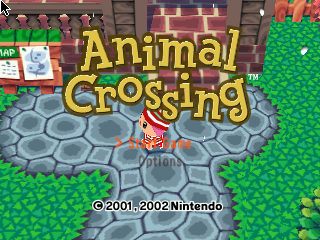
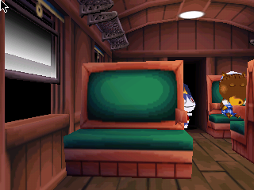
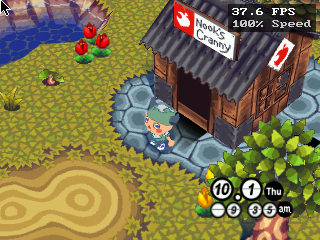
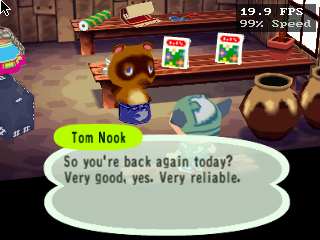
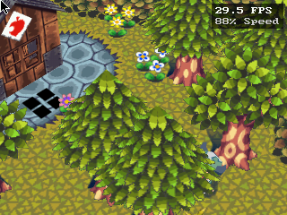
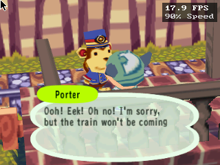

# OpenCrossing for Raspberry Pi Zero 2W & Pi Tin

[](https://www.raspberrypi.com/products/raspberry-pi-zero-2-w/)
[-blue.svg)]()
[-brightgreen.svg)]()
[](LICENSE)

Optimized patches and deployment tooling to run **OpenCrossing** (the native PC/handheld source port and decompilation of *Animal Crossing* for Nintendo GameCube) smoothly on the **Raspberry Pi Zero 2W** (Broadcom BCM2710A1 quad-core Cortex-A53 @ 1.0 GHz, 512 MB RAM, VideoCore IV GPU).

This release includes two standalone patch variants applied directly against upstream [OpenCrossing-Anbernic](https://github.com/GabeConway/OpenCrossing-Anbernic.git) (commit `762ea7a`):
1. **Generic Raspberry Pi Zero 2W**: Tuned for HDMI output to TVs and desktop monitors with standard SDL2 gamepads (Xbox, PlayStation, 8BitDo, USB SNES controllers).
2. **Pi Tin Handheld**: Specialized for ultra-compact custom mint-tin handheld consoles featuring a 2.8" SPI TFT LCD (ILI9341 @ 320x240), GPIOnext physical GPIO button matrices, DispmanX video layer 10010, hardware exit combos, and a thermal/battery-friendly 30 FPS cap.

---

## Important Legal Notice & Asset Disclaimer

> [!IMPORTANT]
> **No copyrighted assets, game ROMs, proprietary game code, or disc images are included in this repository.**
> OpenCrossing is a native reverse-engineered engine implementation. To run the game, you must provide your own legally obtained disc image of *Animal Crossing* for the Nintendo GameCube (`Animal Crossing (USA).iso` or `GAFE01.iso`).

---

## Architectural Highlights & VideoCore IV Optimizations

Running a complex GameCube title on a 1.0 GHz Cortex-A53 with 512 MB RAM and an older Broadcom VideoCore IV GPU requires overcoming several hardware limitations:

* **Static Uber-Shader Pipeline**: Broadcom's VideoCore IV GLES 2.0 driver (`brcmGLESv2`) hangs when compiling and linking shaders mid-frame (`glLinkProgram` deadlocks the GPU firmware IPC queue). These patches introduce an optimized static uber-shader that handles all GameCube TEV (Texture Environment) color/alpha blending stages in a single pass compiled once at startup.
* **CPU Matrix Pre-Transposition**: GLES 2.0 strictly requires `transpose = GL_FALSE` in `glUniformMatrix4fv`. Transformation matrices are pre-transposed on the CPU using NEON SIMD instructions before GPU upload.
* **Decoupled Multi-Threaded Rendering**: Game logic, physics, and world simulation are pinned to **CPU Core 0**, while OpenGL ES render queue processing and draw submission run independently on **CPU Core 1** (`pc_render_thread.c`), ensuring steady frame times.
* **Embedded Framebuffer (EFB) Copy Fix**: Replaces unsupported desktop OpenGL EFB readbacks with a specialized `glCopyTexImage2D` fallback using `GL_RGB` formats, allowing the in-game inventory, pause screen, and letter-writing overlay to render properly without crashing the VideoCore IV driver.
* **Dynamic FPS Governor & View Frustum Culling**: Smoothly paces simulation ticks to maintain 100% gameplay speed while scaling draw call overhead and culling off-screen trees, villager houses, and decorative props.
* **DispmanX Video Layer 10010**: Bypasses the X11 desktop compositor and renders directly to hardware video layer 10010, ensuring game visuals appear seamlessly over background frontend processes (such as EmulationStation).

---

## Repository Structure

```text
release/
├── README.md                           # This comprehensive guide
├── config/
│   ├── settings.ini.generic            # Tuned settings for HDMI TV / standard controllers
│   └── settings.ini.pitin              # Tuned settings for 320x240 LCD / GPIOnext handheld
├── patches/
│   ├── 0001-opencrossing-rpi-zero2w-generic.patch  # Generic Raspberry Pi Zero 2W patch
│   └── 0001-opencrossing-rpi-zero2w-pi-tin.patch  # Pi Tin handheld specialized patch
├── screenshots/                        # Hardware gameplay captures
│   ├── 01_title_screen.png
│   ├── 02_train_carriage.png
│   ├── 03_nooks_cranny.png
│   ├── 04_tom_nook_shop.png
│   ├── 05_town_acre_path.png
│   ├── 06_station_master_porter.png
│   └── 07_town_welcome_ursala.png
└── scripts/
    ├── apply_patch.sh                  # Interactive helper script to clone and patch upstream
    └── launchers/                      # RetroPie Ports menu launcher scripts
        ├── Animal Crossing.sh                  # Stable production launcher
        ├── Animal Crossing (Dev).sh            # Verbose telemetry launcher
        ├── Animal Crossing (Record Input).sh   # Input macro recording session
        └── Animal Crossing (Playback).sh       # Deterministic benchmark replay
```

---

## Screenshots

Captured directly from hardware running on the **Raspberry Pi Zero 2W** (VideoCore IV GPU):

| Title Screen | Train Journey |
| :---: | :---: |
|  |  |
| *Iconic 3D title screen over station cobblestone plaza* | *Interior train carriage with Rover the cat* |

| Nook's Cranny (Town Gameplay) | Tom Nook's Shop |
| :---: | :---: |
|  |  |
| *Outside Nook's Cranny with clock HUD & live 37 FPS* | *Talking to Tom Nook with dialogue bubble alpha* |

| Town Acre Exploration | Station Master Porter |
| :---: | :---: |
|  |  |
| *Outdoor cobblestone path, trees, flowers & house* | *Porter at train station gate with speech bubble* |

| Welcome to Raspboro |
| :---: |
|  |
| *Character introduction sequence under the spotlight* |

---

## Variant Comparison

Feature | Generic RPi Zero 2W | Pi Tin Handheld
:--- | :--- | :---
**Primary Display** | HDMI TV / Monitor (720p / 1080p / Auto) | 2.8" SPI TFT LCD (ILI9341 @ 320x240)
**Controller Input** | Standard SDL2 GameController / Keyboard | GPIOnext Joypad 1 + raw button fallback
**FPS Target** | 60 FPS / Dynamic Governor | 30 FPS Cap (tuned to SPI LCD refresh)
**Scale Mode** | Integer / Aspect Ratio Letterbox (4:3) | Direct Fullscreen (320x240 native)
**In-Engine Exit** | Controller Guide/Back or ESC key | `Select + Start` (Buttons 8+9 or 10+9)
**Screenshot Combo** | Keyboard F12 | `L + R + Select` (Saves BMP to `screenshots/`)
**Decoupled Dual-Core**| Enabled (Core 0 Sim / Core 1 Render) | Enabled (Core 0 Sim / Core 1 Render)
**Static Uber-Shader** | Enabled | Enabled

---

## Quick Start (Automated)

The fastest way to patch OpenCrossing is using the included helper script:

```bash
chmod +x scripts/apply_patch.sh
./scripts/apply_patch.sh
```

The script will prompt you to select your target variant (Generic or Pi Tin), clone the upstream repository at the verified commit (`762ea7a`), apply the selected patch cleanly, and stage the pre-tuned `settings.ini`.

---

## Manual Patching

If you prefer to apply the patch manually:

```bash
# 1. Clone upstream OpenCrossing-Anbernic
git clone https://github.com/GabeConway/OpenCrossing-Anbernic.git
cd OpenCrossing-Anbernic

# 2. Checkout verified base commit
git checkout 762ea7a

# 3. Apply the desired patch
# For Generic Raspberry Pi Zero 2W:
git apply /path/to/patches/0001-opencrossing-rpi-zero2w-generic.patch

# OR for Pi Tin Handheld:
git apply /path/to/patches/0001-opencrossing-rpi-zero2w-pi-tin.patch

# 4. Copy the matching configuration
cp /path/to/config/settings.ini.generic pc/settings.ini   # or settings.ini.pitin
```

---

## Compilation

You can compile natively on the Raspberry Pi or cross-compile on a PC using Docker.

### Method A: Native Compilation on Raspberry Pi OS

> [!NOTE]
> Tested on **Raspbian 10 Buster** and **Raspberry Pi OS 11 Bullseye** (32-bit `armhf`).

1. Install build dependencies:
   ```bash
   sudo apt-get update
   sudo apt-get install -y gcc g++ cmake make ninja-build \
       libsdl2-dev libgles2-mesa-dev
   ```

2. Build using CMake and Ninja:
   ```bash
   cd OpenCrossing-Anbernic/pc
   mkdir -p build && cd build

   # Configure targeting ARM Cortex-A53 NEON vectorization
   cmake .. -G Ninja -DPC_USE_GLES=ON \
     -DCMAKE_C_FLAGS="-mcpu=cortex-a53 -mfpu=neon-vfpv4 -mfloat-abi=hard -O2 -fsigned-char" \
     -DCMAKE_CXX_FLAGS="-mcpu=cortex-a53 -mfpu=neon-vfpv4 -mfloat-abi=hard -O2 -fsigned-char"

   # Compile executable
   ninja
   ```

3. The compiled binary will be placed at `pc/build/bin/AnimalCrossing`.

---

### Method B: Cross-Compilation with Docker (PC / Mac / WSL)

Cross-compiling via Docker is substantially faster than building directly on the Pi Zero 2W hardware:

1. Launch a 32-bit ARM container:
   ```bash
   docker run --rm -it --platform linux/arm/v7 \
     -v "$PWD":/work debian:buster /bin/bash
   ```

2. Inside the container, install packages and compile:
   ```bash
   apt-get update && apt-get install -y --no-install-recommends \
     gcc g++ cmake ninja-build make libsdl2-dev libgles-dev ca-certificates

   cd /work/pc
   mkdir -p build && cd build

   cmake .. -G Ninja -DPC_USE_GLES=ON \
     -DCMAKE_C_FLAGS="-mcpu=cortex-a53 -mfpu=neon-vfpv4 -mfloat-abi=hard -O2 -fsigned-char" \
     -DCMAKE_CXX_FLAGS="-mcpu=cortex-a53 -mfpu=neon-vfpv4 -mfloat-abi=hard -O2 -fsigned-char"

   ninja
   ```

3. Exit the container. The output executable `AnimalCrossing` is ready in `pc/build/bin/`.

---

## Game Setup & Deployment

1. Create a game folder on your Raspberry Pi (e.g. `/home/pi/AnimalCrossing`).
2. Copy the following files into `/home/pi/AnimalCrossing`:
   * `AnimalCrossing` (the compiled executable)
   * `shaders/` directory (containing `default.vert` and `default.frag`)
   * `settings.ini` (from `config/settings.ini.generic` or `settings.ini.pitin`)
   * `rom/` directory containing your legally dumped GameCube ISO:
     ```text
     /home/pi/AnimalCrossing/
     ├── AnimalCrossing
     ├── settings.ini
     ├── shaders/
     │   ├── default.vert
     │   └── default.frag
     └── rom/
         └── Animal Crossing (USA).iso
     ```
3. Make sure the binary is executable:
   ```bash
   chmod +x /home/pi/AnimalCrossing/AnimalCrossing
   ```

---

## RetroPie Ports Integration

To integrate OpenCrossing into your RetroPie setup:

1. Copy the desired launcher scripts from `scripts/launchers/` to `/home/pi/RetroPie/roms/ports/`:
   ```bash
   cp scripts/launchers/*.sh /home/pi/RetroPie/roms/ports/
   chmod +x /home/pi/RetroPie/roms/ports/*.sh
   ```

2. Restart EmulationStation. You will now see four entries in the **Ports** menu:
   * **`Animal Crossing.sh`**: Production launcher. Freezes EmulationStation, applies direct DispmanX video layer 10010, and launches clean gameplay.
   * **`Animal Crossing (Dev).sh`**: Debug launcher with verbose console output recorded to `dev.log`.
   * **`Animal Crossing (Record Input).sh`**: Interactive session that records all controller inputs into `inputs_recorded.acrec` for creating benchmark macros.
   * **`Animal Crossing (Playback).sh`**: Automated benchmark runner that replays recorded inputs with 100% determinism to test framerates and performance.

---

## Controls Reference

Action | Standard Controller (Generic) | Pi Tin Handheld (GPIOnext) | Keyboard
:--- | :--- | :--- | :---
**Movement** | Left Analog Stick / D-Pad | Physical D-Pad | Arrow Keys / WASD
**Action / Talk (A)** | A / South Button (Button 0) | Button A (GPIO Pin 0) | Enter / Space
**Cancel / Run (B)** | B / East Button (Button 1) | Button B (GPIO Pin 1) | Backspace / Shift
**Inventory / Map (X)** | X / West Button (Button 2) | Button X (GPIO Pin 2) | X
**Grab / Drop (Y)** | Y / North Button (Button 3) | Button Y (GPIO Pin 3) | Y
**Camera Zoom (L)** | Left Shoulder (L1) | Button L (GPIO Pin 4) | Q
**Inventory Swap (R)** | Right Shoulder (R1) | Button R (GPIO Pin 5) | E
**Map / Menu (Z)** | Right Trigger (R2) | Button Z (GPIO Pin 7) | Tab
**Pause Menu (Start)** | Start Button (Button 7/9) | Button Start (GPIO Pin 9) | Escape
**In-Game Overlay** | Back / Select Button | Button Select (GPIO Pin 8/10) | F1
**Emergency Clean Exit**| `Select + Start` (Hold) | `Select + Start` (Hold) | Escape (Confirm)
**Screenshot** | Keyboard F12 | `L + R + Select` (Hold) | F12

---

## Performance Tuning Tips

If you experience frame drops in heavily decorated town acres:

1. **Frustum Culling**: Ensure `frustum_cull = 1` in `settings.ini`. This prevents off-screen town decorations, signs, and trees from hitting the render pipeline.
2. **Acre Draw Distance**: Set `reduce_acre_draw = 1` (orthogonal cross) or `reduce_acre_draw = 2` (current acre only) to avoid drawing distant unvisited acres.
3. **Dynamic FPS Governor**: Set `fps_target = 6` in `settings.ini`. This decouples game logic from rendering so clock speed remains 100% accurate even if rendering momentarily drops below 60 FPS.
4. **Resolution Scaling**: On high-resolution HDMI monitors, lower `render_scale` to `75` or `50` to reduce GPU pixel fillrate bottlenecks.

---

## License & Credits

* **OpenCrossing**: Reverse decompilation project by the OpenCrossing contributors.
* **OpenCrossing-Anbernic**: Handheld optimizations and GLES backend work by Gabe Conway.
* **Raspberry Pi Zero 2W & Pi Tin Port**: VideoCore IV GLES 2.0 pipeline, static uber-shader, dual-core decoupled render thread, and RetroPie integration developed by the port contributors.
* Licensed under the GNU General Public License v2.0 (GPL-2.0).
